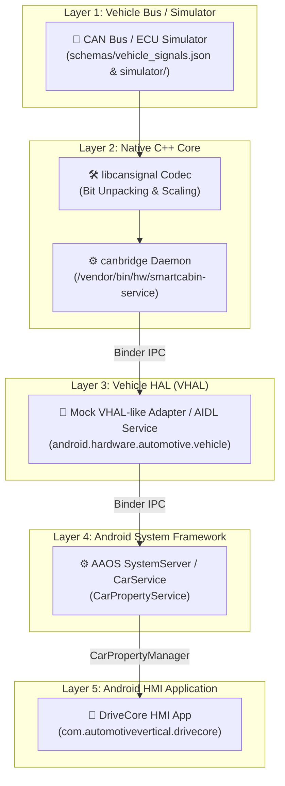

# 🏎️ DriveCore HMI: Android Automotive Vertical Architecture Lab

> **A hands-on Android Automotive vertical architecture lab, from vehicle signal to Android HMI.**

---

## 🎯 Overview

**DriveCore HMI** is a portfolio-grade, end-to-end Android Automotive OS (AAOS) platform engineering lab. Inspired by real-world automotive job requirements (Tier-1 suppliers and OEMs), this project demonstrates how vehicle bus signals travel across every system layer: from electrical CAN frames to native C++ daemons, AIDL/Binder interfaces, AOSP `CarService`, and user-facing HMI applications.



---

## 🛠️ Skills & Competencies Demonstrated

| Skill Area | Key Technology | Architectural Concept |
|------------|----------------|-----------------------|
| **Android Automotive OS** | `CarPropertyManager`, AAOS 15 | Vehicle property subscriptions, change mode handling (`CONTINUOUS` vs `ON_CHANGE`). |
| **AOSP Integration** | Vendor partition isolation, Treble | VINTF manifests, init `.rc` scripts, vendor HAL service registration. |
| **Vehicle Protocols & CAN** | CAN 2.0B, DBC, `SocketCAN` | Bitframe unpacking, factor/offset physical scaling, endianness. |
| **Native C++ Core** | C++17, GoogleTest, CMake | Native daemon loops, lock-free queues, socket abstractions. |
| **Binder IPC & AIDL** | AIDL (`IVehicle.aidl`), Binder | Inter-process communication, asynchronous HAL callbacks, interface versioning. |
| **Android HMI Application** | Kotlin, `StateFlow`, Coroutines | Reactive cockpit state mapping, clean architecture, mock property adapter. |
| **Security & Hardening** | SELinux policies (`.te`) | Vendor domain separation, binder call rules, permission enforcement. |
| **Cross-Layer Diagnostics** | `dumpsys car_service`, Python tracing | Latency measurement, event stream logging, cross-layer debugging. |

---

## 📂 Repository Index

```
.
├── schemas/                # Single Source of Truth vehicle signal database (vehicle_signals.json)
├── simulator/              # Python dynamic vehicle signal & CAN frame generator
├── native/                 # C++ signal codecs, SocketCAN/TCP transport, & canbridge daemon
├── android/                # Android Automotive HMI application
│   └── drivecore-hmi/      # DriveCore HMI Android app (com.automotivevertical.drivecore)
├── diagnostics/            # Signal tracers, latency inspectors, & debugging tools
├── aosp-integration/       # SELinux sepolicy, Android.bp, init .rc blueprints, & VINTF manifests
├── docs/                   # Architectural guides, signal pipeline specs, & interview deep dive
└── tests/                  # Multi-layer contract and schema verification tests
```

---

## 🚦 Source of Truth Signals (`schemas/vehicle_signals.json`)

The lab standardizes 7 required vehicle signals mapped directly to AOSP `VehicleProperty` specifications:

| Signal ID | VHAL Property Name | Data Type | Change Mode | Access | Unit |
|-----------|-------------------|-----------|-------------|--------|------|
| `VEHICLE_SPEED` | `PERF_VEHICLE_SPEED` | `FLOAT` | `CONTINUOUS` | READ | km/h |
| `GEAR_SELECTION` | `GEAR_SELECTION` | `ENUM` | `ON_CHANGE` | READ | enum |
| `PARKING_BRAKE` | `PARKING_BRAKE_ON` | `BOOLEAN` | `ON_CHANGE` | READ | boolean |
| `DOOR_STATE` | `DOOR_POS` | `INT32` | `ON_CHANGE` | READ | bitmask |
| `HVAC_TEMPERATURE` | `HVAC_TEMPERATURE_SET` | `FLOAT` | `ON_CHANGE` | READ_WRITE | °C |
| `TURN_SIGNAL` | `TURN_SIGNAL_STATE` | `ENUM` | `ON_CHANGE` | READ | enum |
| `IGNITION_STATE` | `IGNITION_STATE` | `ENUM` | `ON_CHANGE` | READ | enum |

---

## 🚀 Quickstart Guide

### 1. Run Schema Contract Tests
Validate schema completeness and property constants:
```bash
python3 -m unittest tests/contract/test_signal_schema.py
```

### 2. Launch Dynamic Vehicle Signal Generator
Stream dynamic synthetic vehicle signal state:
```bash
python3 simulator/signal_generator.py 10.0
```

### 3. Build & Run Native C++ Core Tests
Compile and execute native GoogleTest suites:
```bash
cd native && mkdir -p build && cd build
cmake .. && make && ctest --output-on-failure
```

### 4. Build Android HMI (`DriveCore HMI`)
Build the Android Automotive application:
```bash
./gradlew :android:drivecore-hmi:assembleDebug
```

---

## 🗺️ Project Roadmap & Development Phases

- [x] **Phase 1: Signal Schema, Simulator, & Architecture Docs** (Completed)
- [x] **Phase 2: Native C++ Signal Core & Transport Streamer** (Completed)
  - Full DBC signal database mapping for all 7 required vehicle signals.
  - Auto-generated C++ `BlueprintSignals.h` with `SignalBinding` definitions.
  - Native GoogleTest coverage for multi-signal unpacking, `CONTINUOUS` & `ON_CHANGE` semantics.
- [x] **Phase 3: AIDL/Binder Vehicle Property Service** (Completed)
  - Decorator architecture (`CanVehicleHardware`) bridging native `CanBridge` with AOSP `DefaultVehicleHal`.
  - Type conversion utilities (`toVhalPropValue`) and property value rounding.
  - TX write path (`writeProperty`) encoding set requests into CAN frames.
- [ ] **Phase 4: Android Automotive HMI Dashboard**
  - Expanded Jetpack Compose / Custom Automotive UI dashboard with live signal telemetry gauges.
- [ ] **Phase 5: JNI / OpenGL / Surface Rendering Demo**
  - Low-latency native cluster rendering pipeline using ANativeWindow / OpenGL ES.
- [ ] **Phase 6: Audio Focus & Ducking Simulator**
  - Automotive audio zone routing and safety audio ducking manager.
- [ ] **Phase 7: SELinux & AOSP Integration Notes**
  - Full enforcing-mode SELinux policies, AVD integration, and partition deployment.
- [ ] **Phase 8: Diagnostics, Replay, Contract Tests, & CI**
  - CAN log replay harness, automated contract tests, and GitHub Actions CI.

---

## ⚠️ Disclaimers & Terminology

- **Terminology**: This repository uses **"mock VHAL-like adapter"** terminology to represent hardware abstraction layers cleanly for educational and demonstration purposes.
- **Independence**: This project is an independent educational lab. It does **not** contain proprietary code, confidential specifications, or data from any commercial vehicle manufacturer or OEM.
