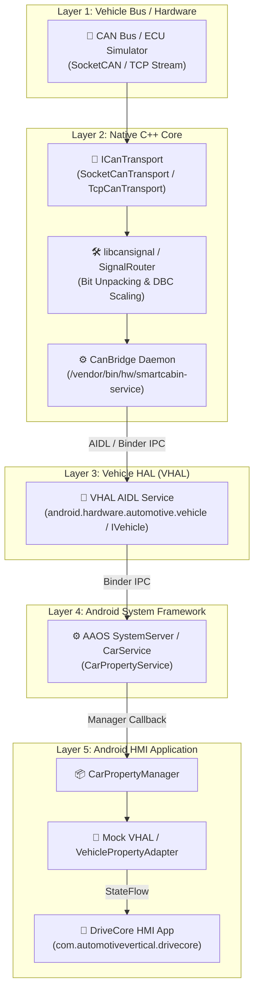

# 🏛️ Vertical Architecture Overview: Vehicle Signal to Android HMI

## 🎯 Why This Project Exists

Modern automotive software development requires engineers who understand the complete vertical slice of an **Android Automotive OS (AAOS)** platform: from electrical CAN wire signals up to user-facing HMI applications.

This repository serves as a **hands-on Android Automotive vertical architecture lab**. It provides a clear, clean, and educational implementation demonstrating how vehicle hardware signals cross hardware abstraction layers (HAL), native C++ daemons, Binder IPC boundaries, Android system services (`CarService`), and finally update the `DriveCore HMI` Android application.

---

## 🛠️ Android Automotive Skills Demonstrated

This lab explicitly covers core technical competencies expected in Android Automotive & System Engineering roles:

1. **AOSP & AAOS Platform Architecture**: Understanding vendor separation, HAL interfaces, system service lifecycle, and `CarPropertyManager` integration.
2. **CAN & Vehicle Signal Protocols**: Frame layout, bit-level DBC signal unpacking, factor/offset scaling, and raw payload deserialization.
3. **Native C++ Daemon Development**: Low-overhead C++ services (`canbridge`), socket programming (SocketCAN & TCP), thread synchronization, and clean architecture.
4. **Binder IPC & AIDL Interfaces**: Defining HAL contracts (`IVehicle.aidl` / `ISmartCabin.aidl`), marshaling typed property values, and handling asynchronous callbacks.
5. **Android HMI Application Engineering**: Reactive Kotlin UI development using `StateFlow`, clean architecture, and mock VHAL property adapters.
6. **Cross-Layer Debugging & Diagnostics**: Using `logcat`, `dumpsys car_service`, and custom telemetry tracers to isolate IPC overhead and signal latency.
7. **SELinux & Security Hardening**: Crafting `sepolicy` (`smartcabin.te`) rules for vendor daemons and binder permissions.

---

## 📡 Upward Signal Flow Journey

---

## 🗺️ Mapping to Standard AOSP / AAOS Concepts

| DriveCore HMI Module | Standard AOSP / AAOS Equivalent | Description |
|----------------------|--------------------------------|-------------|
| `schemas/vehicle_signals.json` | `hardware/interfaces/automotive/vehicle/2.0/types.hal` | Canonical definition of vehicle property IDs, access modes, and data types. |
| `simulator/signal_generator.py` | Vehicle CAN Gateway / ECU | Synthetic signal engine broadcasting CAN frames. |
| `native/canbridge` | VHAL Vendor Backend (`DefaultVehicleHal`) | C++ native daemon converting CAN bitframes into VHAL property values. |
| `vhal/aosp` | `android.hardware.automotive.vehicle@V3-service` | AOSP AIDL Vehicle HAL implementation. |
| `aosp-integration/sepolicy` | `device/oem/car/sepolicy` | SELinux policy rules governing vendor HAL permissions. |
| `android/drivecore-hmi` | OEM Cluster / Cockpit HMI App | User-facing Android application subscribing to vehicle signals. |

---

## 🔮 Future Roadmap Modules

The lab expands incrementally across 8 structured phases:
- **Phase 1**: Signal schema + simulator + docs (Current MVP)
- **Phase 2**: Native C++ signal core
- **Phase 3**: AIDL/Binder vehicle property service
- **Phase 4**: Android Automotive HMI dashboard
- **Phase 5**: JNI / OpenGL / Surface rendering demo
- **Phase 6**: Audio focus & ducking simulator
- **Phase 7**: SELinux & AOSP security integration
- **Phase 8**: Diagnostics, replay, contract tests, CI
